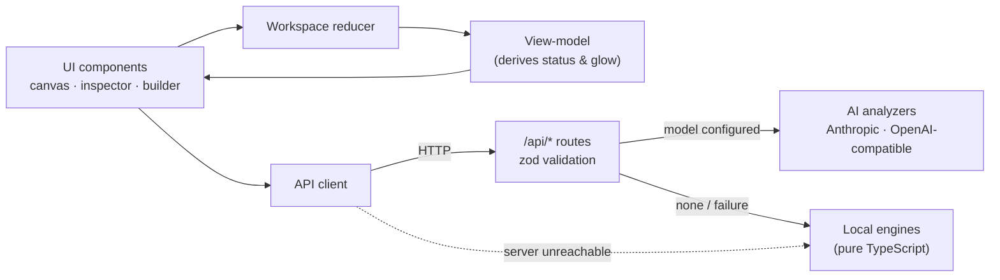

# CodeArchitect AI

**An interactive map of a codebase's architecture.** Map a repository into a live dependency graph, simulate what a change would break before you make it, replay how the architecture evolved, and draw new components to generate the code that wires them in.

Built with Next.js 16 (App Router), React 19, React Flow 12 and Tailwind 4. Analysis can run on **any major AI model** — Claude, OpenAI, Gemini, or free local models through **Ollama** / LM Studio — and falls back to a **deterministic local engine**, so the app is fully usable offline and for free.

---

## Features

| | Feature | What it does |
|---|---|---|
| 🗺️ | **Dependency graph** | A React Flow canvas of components, colour-coded by layer (UI, API route, business logic, data). Animated edges show data flow; there's a minimap, zoom and pan. |
| 💥 | **Blast-radius simulator** | Describe a change (e.g. *"Change `userId` from integer to UUID v4"*). Affected nodes pulse red (breaks) or amber (needs review), and the drawer shows a risk score and a side-by-side diff for every file that must change. |
| ⏳ | **Time-machine story** | Replay commit history on the canvas: components appear as they were introduced, with a narrative for each phase. Paste any `git log --name-status` to build a timeline. |
| 🧩 | **Diagram-to-code builder** | Add components, drag connections between them, and generate the new files plus the edits that wire them into existing ones. |
| 🩺 | **Architecture health** | An A–F grade and a change-risk score per component from structure alone (no AI): circular dependencies, hubs, crossed layers, oversized files. The canvas shows a ring and a "Risk N" chip on every component. |
| 🛡️ | **Architecture rules** | State what must never happen ("the UI must not touch the database", "no cycles", "no component with more than 6 dependents"). Broken rules are drawn on the map and listed in the Health tab. |
| 🤖 | **Pull-request check** | `codearchitect pr --base main` (or the bundled GitHub workflow) reports what a change does to the architecture: new cycles, broken rules, health change and blast radius. It comments on the PR and fails the check on new problems. |
| 🔎 | **Search & focus** | Find a component by name, path or symbol and jump to it. Focus mode dims everything except the selected component and its direct neighbours. |
| 🎓 | **Easy to understand** | A guided tour on first visit, "In plain words" summaries of every component and analysis (with an effort estimate and order of work), tooltips and a glossary. |
| 🔬 | **MATLAB & Python scripts** | Maps research code as a data-flow graph: entry scripts, the functions they call, and the CSV/MAT/image files they read and write. |
| 🧬 | **Provenance trace** | Select any component and trace **where it comes from** (the scripts, functions and raw input files behind a figure or result, across pipeline stages) or **what it affects** (every result that would be out of date if an input changed). The path is numbered on the map and explained in plain words. |
| 📦 | **Import / export** | Import a repository from a ZIP or a GitHub URL. Export the diagram (PNG/SVG, matching what is on screen), a Mermaid file, a Markdown architecture report, the graph JSON, or every component's code plus a manifest that restores the exact graph. |
| 💾 | **Autosave** | Edits (drafts, applied changes, rules, imports) are saved in this browser a moment after you make them and restored on reload. **Reset** returns to the original. |

Three sample projects are built in (*E-Commerce API*, *Auth Microservice*, and a *Power-Systems Study* written in MATLAB). The app also ships a map of **its own codebase** in `public/samples/`; load it via **Custom Upload…** to explore how this project is put together.

## Quick start

Requires Node.js 20+.

```bash
npm install
npm run dev
```

Open http://localhost:3000. No configuration is needed.

**Map your own project:** with the app stopped, run `npm run view -- C:path	oyourproject` (any folder with TypeScript, JavaScript, MATLAB or Python). It analyses the folder, starts the app and opens your browser with that project loaded. Stop the usual `npm run dev` first: one app instance can only show one folder.

**Try it:**

1. Pick **Auth Microservice** in the repository selector.
2. Open **Blast Radius**, click the sample prompt *"Change `userId` from integer to UUID v4"*, then **Run Impact Analysis**.
3. Click **Toggle Time-Machine Story** and press ▶ to watch the architecture build up commit by commit.
4. In **Builder**, add an *"Export PDF Button"*, drag from **User Dashboard**'s bottom handle to its top handle, then click **Generate glue code**.

## Keyboard shortcuts

| Key | Action |
|---|---|
| `/` or `Ctrl`/`⌘`+`K` | Search components |
| `F` | Toggle focus mode (dim everything but the selected component's neighbours) |
| `?` | Replay the guided tour |
| `Enter` / `↑` `↓` / `Esc` | In search: jump to result / move / close |

Shortcuts are ignored while you type in a field.

## Scripts

| Command | Purpose |
|---|---|
| `npm run dev` | Start the dev server |
| `npm run build` / `npm start` | Production build (includes a type check) / serve it |
| `npm run typecheck` | `tsc --noEmit` |
| `npm test` | Unit tests (Vitest) |
| `npm run graph:self` | Regenerate `public/samples/codearchitect-self.graph.json` from the current code and git history |
| `npm run view -- <folder>` | Map a folder on your disk and open it in the app (no zip or upload) |
| `npm run cli -- analyze .` | Health and rule report for a folder (builds the CLI first) |
| `npm run cli -- pr --base main` | Architecture check of the current branch against `main`; exit code 1 when it fails |
| `npm run models` | List the model IDs each configured provider actually serves (helps pick `AI_MODEL`) |
| `npm run test:live` | Score real models on every AI feature (opt-in, makes paid/free-tier API calls; see the development guide) |

## Configuration

All configuration is optional. Copy `.env.example` to `.env.local`. Without any of it, the local engine does everything.

### Choosing an AI model

| Provider | `AI_PROVIDER` | Key variable | Notes |
|---|---|---|---|
| **Ollama** (local, free) | `ollama` | — | Install [Ollama](https://ollama.com), `ollama pull qwen2.5-coder:14b`, set `AI_MODEL` |
| **LM Studio** (local, free) | `lmstudio` | — | Start its local server; set `AI_MODEL` to the loaded model |
| Anthropic Claude | `anthropic` | `ANTHROPIC_API_KEY` | Default model `claude-opus-5-5`; uses native structured outputs |
| OpenAI | `openai` | `OPENAI_API_KEY` | Set `AI_MODEL` |
| Google Gemini | `gemini` | `GEMINI_API_KEY` | Via Gemini's OpenAI-compatible endpoint; set `AI_MODEL` |
| OpenRouter / Groq / DeepSeek | `openrouter` / `groq` / `deepseek` | `OPENROUTER_API_KEY` / `GROQ_API_KEY` / `DEEPSEEK_API_KEY` | Set `AI_MODEL` |
| Any OpenAI-compatible server | `custom` | `AI_API_KEY` (optional) | Set `AI_BASE_URL` and `AI_MODEL` (vLLM, llama.cpp server, LocalAI, Azure, …) |

Free local example (`.env.local`):

```bash
AI_PROVIDER=ollama
AI_MODEL=qwen2.5-coder:14b
```

If `AI_PROVIDER` is empty, the first provider whose key is set is used. Existing setups with only `ANTHROPIC_API_KEY` keep working unchanged.

| Variable | Default | Effect |
|---|---|---|
| `AI_PROVIDER`, `AI_MODEL` | auto / preset | Which provider and model to use |
| `AI_BASE_URL`, `AI_API_KEY` | preset | Override the endpoint or key for any provider |
| `AI_MAX_INPUT_CHARS` | preset | Source characters per request: 40k for local models, 200k–600k for hosted ones |
| `CODEARCHITECT_ENGINE` | `auto` | `local` never calls a model. (`claude` is a legacy alias that forces Anthropic) |
| `GITHUB_TOKEN` | — | Raises GitHub's rate limit for URL imports |

The top bar shows which engine is active. A misconfiguration, such as a missing model or key, is reported there rather than silently ignored.

> A claude.ai Pro/Max or ChatGPT Plus subscription does **not** include API access; hosted APIs are billed separately. Ollama and LM Studio cost nothing.

## How it works



- **Status is derived, not stored.** Nodes hold facts about the code; the impact, story and draft overlays are computed every render, so modes can't leave stale state behind.
- **Edges point from dependent to dependency**, so a blast radius is a reverse BFS from the changed node, O(V+E).
- **AI is optional, provider-neutral and checked.** Every model's output is validated with the same Zod schemas (with one automatic repair retry for malformed JSON) and then against the graph: unknown node IDs are dropped, depths are recomputed, and "before" code always comes from the graph itself. Any model failure falls back to the local engine with a visible warning.

## Documentation

| Doc | Contents |
|---|---|
| [Architecture](docs/architecture.md) | Layers, data flow, state model, key design decisions |
| [API reference](docs/api.md) | Every route: request, response, errors, limits |
| [Analysis engines](docs/engines.md) | Algorithms: impact ranking and severity, risk score, health scoring, script data-flow, search ranking, diff, repo mapping, git parsing, scaffolding |
| [Rules, CLI and CI](docs/cli-and-ci.md) | Writing rules, the `analyze` and `pr` commands, exit codes, and the GitHub workflow |
| [Graph format](docs/graph-format.md) | The `codearchitect/v1` JSON manifest, for building your own graphs |
| [Development guide](docs/development.md) | Project layout, testing, adding samples and scenarios, Next.js 16 notes |

## Project status and limits

- The local engine's impact diffs are exact only for **authored scenarios**. For other prompts it marks the affected lines heuristically, and an AI model is needed for concrete code edits.
- Repository mapping by the local engine is file-level: one node per file, at most 60 files. An AI model groups files into architectural components instead.
- Applied refactors and scaffolds change the in-memory model only. Use **Export → Code base** to get the files; nothing is written to your repository.
- Autosave is per browser (IndexedDB): it is not shared across devices or browsers, and private windows may not keep it. Export the graph to move it elsewhere. Only edits to the graph are saved, not which panel or overlay was open.
- Script mapping reads string literals: file names built at run time (`[name '_base.csv']`) appear as patterns, files passed through variables to a helper function are linked to the script that names them rather than to the helper, and nothing is executed. Data file contents are never read.
- Health scores are structural heuristics for deciding where to look first, not a verdict on code quality.
- The PR check maps source files and their imports. It cannot see dynamic imports with computed paths or runtime-injected dependencies, and a renamed file shows as one removed and one added component.
