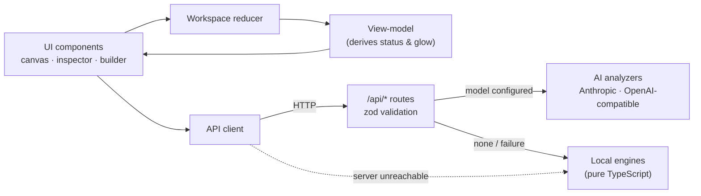

# CodeArchitect AI

*Created and owned by **Hussain Tak** ([@imhussain001](https://github.com/imhussain001)). Copyright © 2026 Hussain Tak. Licensed under the [Apache License 2.0](LICENSE).*

**An interactive map of a codebase's architecture.** Map a repository into a live dependency graph, simulate what a change would break before you make it, replay how the architecture evolved, and draw new components to generate the code that wires them in.

Built with Next.js 16 (App Router), React 19, React Flow 12 and Tailwind 4. Analysis can run on **any major AI model** — Claude, OpenAI, Gemini, or free local models through **Ollama** / LM Studio — and falls back to a **deterministic local engine**, so the app is fully usable offline and for free.

---

## Features

| | Feature | What it does |
|---|---|---|
| 🗺️ | **Dependency graph** | A React Flow canvas of components, colour-coded by layer (UI, API route, business logic, data). Animated edges show data flow; there's a minimap, zoom and pan. |
| 💥 | **Blast-radius simulator** | Describe a change (e.g. *"Change `userId` from integer to UUID v4"*). Affected nodes pulse red (breaks) or amber (needs review), and the drawer shows a risk score and a side-by-side diff for every file that must change. |
| ⏳ | **Time-machine story** | Replay commit history on the canvas: components appear as they were introduced, with a narrative for each phase. Paste any `git log --name-status` to build a timeline. |
| 🧩 | **Diagram-to-code builder** | Add components, drag connections between them, and generate the new files plus the edits that wire them into existing ones. |
| 🩺 | **Architecture health** | An A–F grade and a change-risk score per component from structure alone (no AI): circular dependencies, hubs, crossed layers, oversized files. The canvas shows a ring and a "Risk N" chip on every component. |
| 🛡️ | **Architecture rules** | State what must never happen ("the UI must not touch the database", "no cycles", "no component with more than 6 dependents"). Broken rules are drawn on the map and listed in the Health tab. |
| 🤖 | **Pull-request check** | `codearchitect pr --base main` (or the bundled GitHub workflow) reports what a change does to the architecture: new cycles, broken rules, health change and blast radius. It comments on the PR and fails the check on new problems. |
| 🔎 | **Search & focus** | Find a component by name, path or symbol and jump to it. Focus mode dims everything except the selected component and its direct neighbours. |
| 🎓 | **Easy to understand** | A guided tour on first visit, "In plain words" summaries of every component and analysis (with an effort estimate and order of work), tooltips and a glossary. |
| 🔬 | **MATLAB & Python scripts** | Maps research code as a data-flow graph: entry scripts, the functions they call, and the CSV/MAT/image files they read and write, laid out in pipeline order (entry scripts → analysis → plots → data files). Pair it with the **Provenance trace** below to answer *"which scripts and inputs produced this figure?"* and *"what goes stale if I change this file?"*; pull requests list the output files that need re-running. See [Research code](docs/research-scripts.md). |
| 🧬 | **Provenance trace** | Select any component and trace **where it comes from** (the scripts, functions and raw input files behind a figure or result, across pipeline stages) or **what it affects** (every result that would be out of date if an input changed). The path is numbered on the map and explained in plain words. |
| 🧩 | **VS Code extension** | `extensions/vscode`: an **architecture map** tab shows the graph beside your code with the files affected by the open file highlighted, the status bar shows how many files a change to the active file affects, CodeLens shows `used by N files` above each export, and a command lists exactly who uses a symbol (importers that don't use it are spared). Install steps [below](#install-the-vs-code-extension). |
| 📉 | **Architecture drift** | `npm run cli -- history .` re-analyses sampled commits and reports whether health, cycles and rule violations are improving or declining, with the commits that made it worse. `npm run view -- . --history` shows the same chart in the Story tab. |
| 🔗 | **Shareable page** | **Export → Shareable page**, or `npm run cli -- share <folder>`, writes one self-contained `.html` file (no server, no network) with a pan/zoom diagram, search, the reading-order guide and per-component code, uses and used-by. Attach it to a PR, email it, or publish it from CI. |
| 🧭 | **Guide (new here?)** | The first inspector tab explains an unfamiliar codebase: the shape in one sentence, the most-used components, what to read carefully before changing, and a numbered reading order. Next/Previous steps through it on the canvas. The same "Where to start" section opens the Markdown report. |
| 🦀 | **Rust** | Maps Rust crates through their module tree: `use crate::a::B`, `self::`, `super::`, nested `use a::{b, c::D}` groups, globs and workspace crates resolve to the file defining the module, with the imported items as symbols. `main.rs`, `lib.rs` and `src/bin/*` are entry points. |
| ☕ | **Java** | Maps Java projects: an import links a class to the file that declares it, wildcard and static imports are followed, and classes in one package that use each other are linked without an import. Controllers, configuration and `*Application` classes count as entry points; test classes are skipped. |
| 🐹 | **Go** | Maps Go modules: each import links a file to the files that define the exported names it uses (`auth.VerifyToken` → the file declaring it), so blast radius is symbol-precise. `cmd/` and `main.go` count as entry points. |
| 🎯 | **Symbol-level impact** | For TypeScript/JavaScript, see which *functions and types* each file uses from another. Simulating a change to one export only flags the files that use it, and unused exports are called out. |
| 📦 | **Import / export** | Import a repository from a ZIP or a GitHub URL. Export the diagram (PNG/SVG, matching what is on screen), a Mermaid file, a Markdown architecture report, the graph JSON, or every component's code plus a manifest that restores the exact graph. |
| 💾 | **Autosave** | Edits (drafts, applied changes, rules, imports) are saved in this browser a moment after you make them and restored on reload. **Reset** returns to the original. |

Three sample projects are built in (*E-Commerce API*, *Auth Microservice*, and a *Power-Systems Study* written in MATLAB). The app also ships a map of **its own codebase** in `public/samples/`; load it via **Custom Upload…** to explore how this project is put together.

## Supported languages

| Language | What is mapped | Symbol-level links | Notes |
|---|---|---|---|
| TypeScript / JavaScript | `import`, `require`, dynamic `import()`, re-exports; `@/` and `~/` aliases | Yes (names each file uses from another) | Type-only imports are kept for rules and blast radius, ignored by health |
| Python | Imports by name (`from a import B` → the file defining `B`), `from pkg import module`, relative and aliased imports, plus the data files each script reads and writes | Yes | Deferred (in-function) and `TYPE_CHECKING` imports are not reported as cycles; data-flow graph, see [Research code](docs/research-scripts.md) |
| MATLAB | Function calls between `.m` files, plus the data files each script reads and writes | No | Data-flow graph, see [Research code](docs/research-scripts.md) |
| Go | Imports resolved to the files declaring the exported names used; same-package use | Yes | Module path inferred from the imports |
| Java | Imports (explicit, static, wildcard) and same-package use | Types | Controllers, configuration and `*Application` classes are entry points |
| Rust | `use` paths through the module tree, workspace crates | Items | `main.rs`, `lib.rs`, `src/bin/*` are entry points |

All of it is lexical analysis (no type checker or compiler), so the map shows where to look rather than proving what breaks. Per-language rules and limits are in [Analysis engines](docs/engines.md).

## Research code (MATLAB and Python)

Analysis scripts are mapped as a **data flow**, not just an import web:

- **Entry scripts** (nothing calls them), the **functions** they call, **plots**, and every **data file** (CSV, MAT, Excel, JSON, HDF5, NumPy, images) a script reads or writes, as nodes of their own.
- **Where it comes from / What it affects** (Inspector → Trace) numbers the path from raw inputs to a figure, or highlights every result that goes stale when an input changes, across pipeline stages.
- **Pull requests** get a line listing the output files that may be out of date and need re-running.
- Everything else works too: health grade, rules, reading-order Guide, shareable page, history over time.

Try it: pick **Power-Systems Study (MATLAB)** in the repository selector, click `nrmse_results.csv`, and press **Where it comes from**. To map your own project, run `npm run view -- C:\path\to\your\project` or use **Custom Upload…**. Full guide, algorithm and limits (run-time-built file names, column-level use, simulation case files): [docs/research-scripts.md](docs/research-scripts.md).

## Install the VS Code extension

The extension shows, inside VS Code, how many files a change to the current file affects (status bar), `used by N files` above each export (CodeLens), and a command that lists exactly who uses a symbol. It is built from this repository and runs entirely locally. You need Node.js 20+ and VS Code 1.85+.

**1. Build the package** (in the project folder, after `npm install`):

```bash
npm run ext:package
```

This creates `extensions/vscode/codearchitect.vsix`.

**2. Install it** with either:

```bash
code --install-extension extensions/vscode/codearchitect.vsix
```

or in VS Code: open the **Extensions** view (`Ctrl+Shift+X`), click the **`…`** menu, choose **Install from VSIX…**, and pick `extensions/vscode/codearchitect.vsix`.

**3. Check it:** reload the window, open a folder with TypeScript, JavaScript, Go, Java or Rust code, and open a file. The status bar shows `N files affected`, and `Ctrl+Shift+P` → `CodeArchitect` lists five commands. To update, run both commands again with `--force`; to remove: `code --uninstall-extension imhussain001.codearchitect-vscode`.

Settings, troubleshooting (`'code' is not recognized`, no status-bar item) and development mode: [docs/vscode-extension.md](docs/vscode-extension.md).

## Quick start

Requires [Node.js](https://nodejs.org) 20 or newer. Check with `node --version`.

**1. Open a terminal in the project folder.** Every `npm` command must run *inside* this folder, or you get `ENOENT … package.json`.

| Where you start | Command |
|---|---|
| Windows Command Prompt | `cd /d E:\codearchitect-ai` (the `/d` switches drive as well as folder) |
| Windows PowerShell | `cd E:\codearchitect-ai` |
| macOS / Linux | `cd path/to/codearchitect-ai` |

**2. Install, once** (and again after pulling new changes):

```bash
npm install
```

**3. Start the app:**

```bash
npm run dev
```

**4. Open the address it prints**, normally http://localhost:3000 (another port if 3000 is taken). Stop it with `Ctrl+C`. No configuration or API key is needed; without one it uses the built-in local engine.

**Troubleshooting**

- `Could not read package.json` / `ENOENT`: you are not in the project folder (step 1).
- `Cannot find module …`: run `npm install` (step 2).
- Port already in use: run `npm run dev -- --port 3100`.

**Map your own project:** with the app stopped, run `npm run view -- C:\path\to\your\project` (any folder with TypeScript, JavaScript, Java, Rust, Go, MATLAB or Python). It analyses the folder, starts the app and opens your browser with that project loaded. Stop the usual `npm run dev` first: one app instance can only show one folder.

**Try it:**

1. Pick **Auth Microservice** in the repository selector.
2. Open **Blast Radius**, click the sample prompt *"Change `userId` from integer to UUID v4"*, then **Run Impact Analysis**.
3. Click **Toggle Time-Machine Story** and press ▶ to watch the architecture build up commit by commit.
4. In **Builder**, add an *"Export PDF Button"*, drag from **User Dashboard**'s bottom handle to its top handle, then click **Generate glue code**.

## Keyboard shortcuts

| Key | Action |
|---|---|
| `/` or `Ctrl`/`⌘`+`K` | Search components |
| `F` | Toggle focus mode (dim everything but the selected component's neighbours) |
| `?` | Replay the guided tour |
| `Enter` / `↑` `↓` / `Esc` | In search: jump to result / move / close |

Shortcuts are ignored while you type in a field.

## Scripts

| Command | Purpose |
|---|---|
| `npm run dev` | Start the dev server |
| `npm run build` / `npm start` | Production build (includes a type check) / serve it |
| `npm run typecheck` | `tsc --noEmit` |
| `npm test` | Unit tests (Vitest) |
| `npm run graph:self` | Regenerate `public/samples/codearchitect-self.graph.json` from the current code and git history |
| `npm run view -- <folder>` | Map a folder on your disk and open it in the app (no zip or upload) |
| `npm run cli -- history .` | Health, cycles and rule violations over time, and the commits that made them worse |
| `npm run cli -- share <folder> --output map.html` | One self-contained, explorable HTML page of a folder's architecture |
| `npm run cli -- analyze .` | Health and rule report for a folder (builds the CLI first) |
| `npm run cli -- pr --base main` | Architecture check of the current branch against `main`; exit code 1 when it fails |
| `npm run models` | List the model IDs each configured provider actually serves (helps pick `AI_MODEL`) |
| `npm run test:live` | Score real models on every AI feature (opt-in, makes paid/free-tier API calls; see the development guide) |

## Configuration

All configuration is optional. Copy `.env.example` to `.env.local`. Without any of it, the local engine does everything.

### Choosing an AI model

| Provider | `AI_PROVIDER` | Key variable | Notes |
|---|---|---|---|
| **Ollama** (local, free) | `ollama` | — | Install [Ollama](https://ollama.com), `ollama pull qwen2.5-coder:14b`, set `AI_MODEL` |
| **LM Studio** (local, free) | `lmstudio` | — | Start its local server; set `AI_MODEL` to the loaded model |
| Anthropic Claude | `anthropic` | `ANTHROPIC_API_KEY` | Default model `claude-opus-5-5`; uses native structured outputs |
| OpenAI | `openai` | `OPENAI_API_KEY` | Set `AI_MODEL` |
| Google Gemini | `gemini` | `GEMINI_API_KEY` | Via Gemini's OpenAI-compatible endpoint; set `AI_MODEL` |
| OpenRouter / Groq / DeepSeek | `openrouter` / `groq` / `deepseek` | `OPENROUTER_API_KEY` / `GROQ_API_KEY` / `DEEPSEEK_API_KEY` | Set `AI_MODEL` |
| Any OpenAI-compatible server | `custom` | `AI_API_KEY` (optional) | Set `AI_BASE_URL` and `AI_MODEL` (vLLM, llama.cpp server, LocalAI, Azure, …) |

Free local example (`.env.local`):

```bash
AI_PROVIDER=ollama
AI_MODEL=qwen2.5-coder:14b
```

If `AI_PROVIDER` is empty, the first provider whose key is set is used. Existing setups with only `ANTHROPIC_API_KEY` keep working unchanged.

| Variable | Default | Effect |
|---|---|---|
| `AI_PROVIDER`, `AI_MODEL` | auto / preset | Which provider and model to use |
| `AI_BASE_URL`, `AI_API_KEY` | preset | Override the endpoint or key for any provider |
| `AI_MAX_INPUT_CHARS` | preset | Source characters per request: 40k for local models, 200k–600k for hosted ones |
| `CODEARCHITECT_ENGINE` | `auto` | `local` never calls a model. (`claude` is a legacy alias that forces Anthropic) |
| `GITHUB_TOKEN` | — | Raises GitHub's rate limit for URL imports |

The top bar shows which engine is active. A misconfiguration, such as a missing model or key, is reported there rather than silently ignored.

> A claude.ai Pro/Max or ChatGPT Plus subscription does **not** include API access; hosted APIs are billed separately. Ollama and LM Studio cost nothing.

## How it works



- **Status is derived, not stored.** Nodes hold facts about the code; the impact, story and draft overlays are computed every render, so modes can't leave stale state behind.
- **Edges point from dependent to dependency**, so a blast radius is a reverse BFS from the changed node, O(V+E).
- **AI is optional, provider-neutral and checked.** Every model's output is validated with the same Zod schemas (with one automatic repair retry for malformed JSON) and then against the graph: unknown node IDs are dropped, depths are recomputed, and "before" code always comes from the graph itself. Any model failure falls back to the local engine with a visible warning.

## License and ownership

**CodeArchitect AI is created, owned and maintained by Hussain Tak** ([@imhussain001](https://github.com/imhussain001)). Copyright © 2026 Hussain Tak.

It is licensed under the **Apache License, Version 2.0** (full text in [LICENSE](LICENSE)). In plain words, and without replacing the license text: anyone may use, modify and redistribute the software, including commercially, **provided they keep the copyright notice and the [NOTICE](NOTICE) file (which names the author)**, mark files they changed, and do not use the author's name or marks to endorse their own product. It comes with no warranty. The license also grants a patent license from contributors and ends it for anyone who sues over the software's patents.

- Contributions: unless you say otherwise, anything you submit for inclusion is licensed under the same license (section 5). Contributors are listed in [AUTHORS.md](AUTHORS.md) with their permission.
- Third-party software keeps its own licenses: see [THIRD_PARTY_NOTICES.md](THIRD_PARTY_NOTICES.md) (regenerate it with `npm run notices`). All production dependencies are permissive; `jszip` is dual-licensed and used under MIT.
- Output you generate with the tool (reports, diagrams, shareable pages) is yours. Shareable pages and reports carry a small "made with CodeArchitect AI" credit; you may remove it from your own copies.

## Documentation

| Doc | Contents |
|---|---|
| [Architecture](docs/architecture.md) | Layers, data flow, state model, key design decisions |
| [API reference](docs/api.md) | Every route: request, response, errors, limits |
| [Analysis engines](docs/engines.md) | Algorithms: impact ranking and severity, risk score, health scoring, script data-flow, search ranking, diff, repo mapping, git parsing, scaffolding |
| [VS Code extension](docs/vscode-extension.md) | What the extension shows, how to build and install it (command line or from the window), settings, troubleshooting |
| [Research code](docs/research-scripts.md) | MATLAB and Python data-flow mapping: layers, provenance, stale outputs in pull requests, how scripts are read, limits |
| [Rules, CLI and CI](docs/cli-and-ci.md) | Writing rules, the `analyze` and `pr` commands, exit codes, and the GitHub workflow |
| [Graph format](docs/graph-format.md) | The `codearchitect/v1` JSON manifest, for building your own graphs |
| [Development guide](docs/development.md) | Project layout, testing, adding samples and scenarios, Next.js 16 notes |

## Project status and limits

- The local engine's impact diffs are exact only for **authored scenarios**. For other prompts it marks the affected lines heuristically, and an AI model is needed for concrete code edits.
- Repository mapping by the local engine is file-level: one node per file, at most 60 files. An AI model groups files into architectural components instead.
- Applied refactors and scaffolds change the in-memory model only. Use **Export → Code base** to get the files; nothing is written to your repository.
- Autosave is per browser (IndexedDB): it is not shared across devices or browsers, and private windows may not keep it. Export the graph to move it elsewhere. Only edits to the graph are saved, not which panel or overlay was open.
- **Phones and tablets.** The app and the shareable page lay out in one column on a narrow screen (compact header, the map above the inspector, the minimap and the colour key trimmed so they do not cover the diagram), and the shareable page supports pinch-to-zoom. A map with dozens of components is still small on a phone: use search, the Guide tab or the page's reading order to jump to a component instead of panning. Checked by hand in a 375px browser at tablet and phone sizes; not on physical devices.
- Script mapping reads string literals: file names built at run time (`[name '_base.csv']`) appear as patterns, files passed through variables to a helper function are linked to the script that names them rather than to the helper, and nothing is executed. Data file contents are never read.
- Health scores are structural heuristics for deciding where to look first, not a verdict on code quality.
- The PR check maps source files and their imports. It cannot see dynamic imports with computed paths or runtime-injected dependencies, and a renamed file shows as one removed and one added component.
