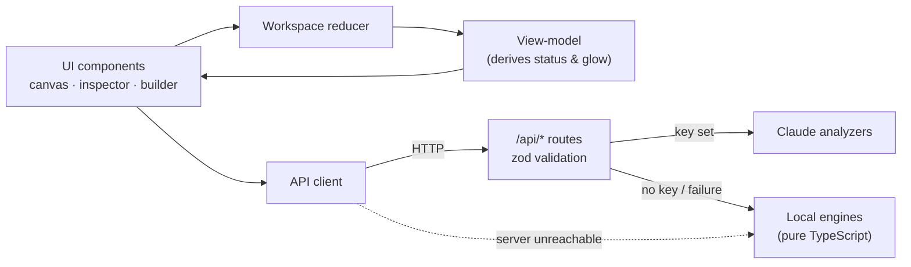

# CodeArchitect AI

**An interactive map of a codebase's architecture.** Map a repository into a live dependency graph, simulate what a change would break before you make it, replay how the architecture evolved, and draw new components to generate the code that wires them in.

Built with Next.js 16 (App Router), React 19, React Flow 12 and Tailwind 4. Analysis runs on **Claude** when an API key is configured; otherwise a **deterministic local engine** does the work, so the app is fully usable offline and for free.

---

## Features

| | Feature | What it does |
|---|---|---|
| 🗺️ | **Dependency graph** | A React Flow canvas of components, colour-coded by layer (UI, API route, business logic, data). Animated edges show data flow; there's a minimap, zoom and pan. |
| 💥 | **Blast-radius simulator** | Describe a change (e.g. *"Change `userId` from integer to UUID v4"*). Affected nodes pulse red (breaks) or amber (needs review), and the drawer shows a risk score and a side-by-side diff for every file that must change. |
| ⏳ | **Time-machine story** | Replay commit history on the canvas: components appear as they were introduced, with a narrative for each phase. Paste any `git log --name-status` to build a timeline. |
| 🧩 | **Diagram-to-code builder** | Add components, drag connections between them, and generate the new files plus the edits that wire them into existing ones. |
| 📦 | **Import / export** | Import a repository from a ZIP or a GitHub URL. Export every component's code plus a manifest that restores the exact graph. |

Two sample repositories are built in (*E-Commerce API*, *Auth Microservice*). The app also ships a map of **its own codebase** in `public/samples/`; load it via **Custom Upload…** to explore how this project is put together.

## Quick start

Requires Node.js 20+.

```bash
npm install
npm run dev
```

Open http://localhost:3000. No configuration is needed.

**Try it:**

1. Pick **Auth Microservice** in the repository selector.
2. Open **Blast Radius**, click the sample prompt *"Change `userId` from integer to UUID v4"*, then **Run Impact Analysis**.
3. Click **Toggle Time-Machine Story** and press ▶ to watch the architecture build up commit by commit.
4. In **Builder**, add an *"Export PDF Button"*, drag from **User Dashboard**'s bottom handle to its top handle, then click **Generate glue code**.

## Scripts

| Command | Purpose |
|---|---|
| `npm run dev` | Start the dev server |
| `npm run build` / `npm start` | Production build (includes a type check) / serve it |
| `npm run typecheck` | `tsc --noEmit` |
| `npm test` | Unit tests (Vitest) |
| `npm run graph:self` | Regenerate `public/samples/codearchitect-self.graph.json` from the current code and git history |

## Configuration

All configuration is optional. Copy `.env.example` to `.env.local`.

| Variable | Default | Effect |
|---|---|---|
| `ANTHROPIC_API_KEY` | — | Enables Claude (`claude-opus-5-5`) for every analysis route |
| `CODEARCHITECT_ENGINE` | `auto` | `auto`: use Claude if a key is present. `local`: never call Claude. `claude`: always try Claude, e.g. with an `ant auth login` profile |
| `GITHUB_TOKEN` | — | Raises GitHub's rate limit for URL imports |

> A claude.ai Pro or Max subscription does **not** include API access. API keys come from the [Anthropic Console](https://console.anthropic.com) and are billed separately.

## How it works



- **Status is derived, not stored.** Nodes hold facts about the code; the impact, story and draft overlays are computed every render, so modes can't leave stale state behind.
- **Edges point from dependent to dependency**, so a blast radius is a reverse BFS from the changed node, O(V+E).
- **Claude is optional and checked.** Its output is validated against the graph: unknown node IDs are dropped, depths are recomputed, and "before" code always comes from the graph itself. Any Claude failure falls back to the local engine with a visible warning.

## Documentation

| Doc | Contents |
|---|---|
| [Architecture](docs/architecture.md) | Layers, data flow, state model, key design decisions |
| [API reference](docs/api.md) | Every route: request, response, errors, limits |
| [Analysis engines](docs/engines.md) | Algorithms: impact ranking and severity, risk score, diff, repo mapping, git parsing, scaffolding |
| [Graph format](docs/graph-format.md) | The `codearchitect/v1` JSON manifest, for building your own graphs |
| [Development guide](docs/development.md) | Project layout, testing, adding samples and scenarios, Next.js 16 notes |

## Project status and limits

- The local engine's impact diffs are exact only for **authored scenarios**. For other prompts it marks the affected lines heuristically, and Claude is needed for concrete code edits.
- Repository mapping by the local engine is file-level: one node per file, at most 60 files. Claude groups files into architectural components instead.
- Applied refactors and scaffolds change the in-memory model only. Use **Export Code Base** to get the files; nothing is written to your repository.
- Graph state is not persisted between page reloads. Export the graph to keep it.
