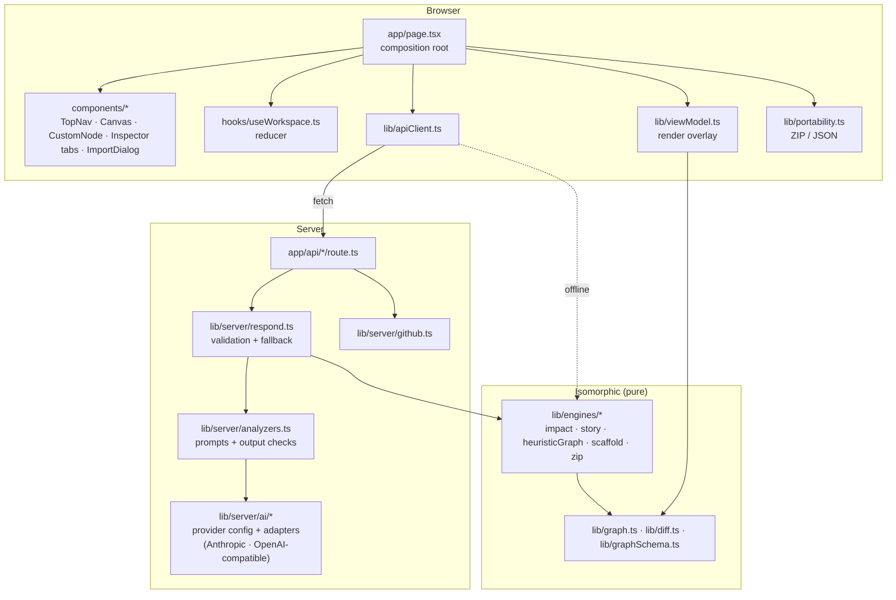
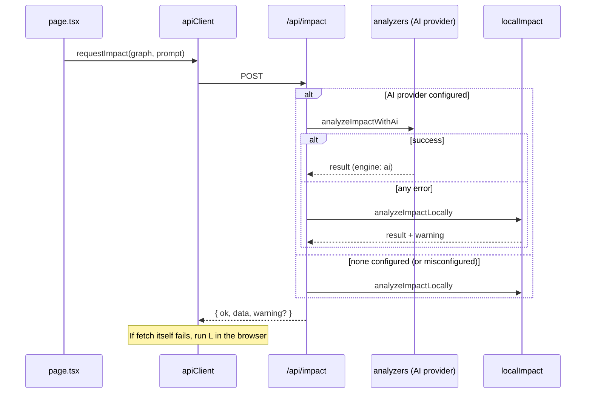

# Architecture

CodeArchitect AI is a single Next.js 16 App Router application. The page is one client component. Five route handlers provide server-side analysis, and every analysis algorithm is a pure TypeScript module that can run in the browser or on the server.

## Layers



| Layer | Responsibility | Must not |
|---|---|---|
| `components/` | Render state and emit intents | Hold business logic or call `fetch` |
| `hooks/useWorkspace.ts` | The single source of UI state; pure reducer | Do I/O |
| `lib/viewModel.ts` | Derive per-node and per-edge status, visibility and styling | Mutate state |
| `lib/engines/`, `lib/graph.ts`, `lib/diff.ts` | Deterministic algorithms | Import React, Next or server-only modules |
| `lib/server/` | AI providers, GitHub and request validation (`import "server-only"`) | Run in the browser (enforced at build time) |
| `app/api/` | Thin handlers: parse → choose engine → respond | Contain analysis logic |

## Domain model

All types live in `lib/types.ts`.

- **`ArchitectureGraph`**: `nodes`, `edges`, `commits` (time-machine frames), `scenarios` (authored impact analyses) and optional `warnings`.
- **`ArchNode`**: a React Flow `Node<NodeData, "component">`. `NodeData` holds only facts about the code: label, kind, file path, code, exports, imports, params, keywords, and `isDraft` for builder nodes.
- **`DependencyEdge`**: `source` depends on `target`. Arrows therefore follow call or data flow, and a change propagates against the arrows.
- **`NodeStatus`** (`normal | modified | added | impacted | broken | proposed`) is never stored. `buildRenderGraph` computes it from the current mode.

### Why status is derived

Four modes can colour the canvas: health overlay, story frame, impact analysis and builder drafts. If each wrote a status into the nodes, switching modes would need cleanup code, and any missed path would leave a stale glow on the canvas. Instead `lib/viewModel.ts` recomputes the overlay on every render, with fixed precedence:

```
health overlay  >  story frame  >  impact analysis  >  draft (proposed)  >  normal
```

The health overlay is on whenever the Health tab is open, so it is derived from the active tab rather than stored. Two things are independent of that precedence: **focus dimming** (the selected component and its direct neighbours stay bright, everything else is dimmed) and **selection**, which comes from app state so selecting from a side panel highlights the node just like clicking it.

**Pan to a component.** Panels outside the canvas cannot call React Flow, so `app/page.tsx` keeps a `{ nodeId, nonce }` request; a controller inside the canvas runs `fitView` whenever a new nonce arrives. Search, the health lists and the impact lists all use it.

The cost is one O(V+E) pass per render, which is negligible at the graph sizes involved (≤ 200 nodes by schema).

## State management

`useReducer` with one `WorkspaceState`:

```ts
{
  graph, selectedNodeId, activeTab, impactPrompt,
  impact:   { status, result, error },
  story:    { enabled, index, isPlaying, narrative, status },
  scaffold: { status, result, error },
  notice,
}
```

Reducer guarantees, covered by `tests/workspaceReducer.test.ts`:

- **Real components cannot be deleted from the canvas.** Only `isDraft` nodes and edges accept `remove` changes, because the graph mirrors a codebase.
- **Story mode and impact analysis are mutually exclusive.** Enabling one clears the other.
- **`applyImpact` / `applyScaffold`** write the proposed code into the nodes and clear the result. The change exists only in memory until the user exports.

React Flow runs in **controlled** mode. Node changes (drag, measure, select) go through `applyNodeChanges` inside the reducer, so positions survive mode switches.

**Async safety:** each async flow captures the graph ID before awaiting and discards the result if the user switched repositories meanwhile (`graphIdRef` in `app/page.tsx`).

## Engine selection and fallback



| Flow | Server fallback | Browser fallback when the server is unreachable |
|---|---|---|
| Impact | local engine | local engine |
| Scaffold | templates | templates |
| Repo from uploaded files | heuristic mapper | heuristic mapper |
| Repo from GitHub URL | heuristic mapper | — (needs the server) |
| Story narration | commit-derived narratives | — |

## Trust boundaries

1. **Browser → API.** Every body is validated with bounded zod schemas (`lib/graphSchema.ts`, `lib/server/schemas.ts`): node, edge and code size limits, prompt ≤ 2,000 characters. See [api.md](api.md#limits).
2. **API → GitHub.** Only `https://github.com/<owner>/<repo>[/tree/<ref>]` URLs are accepted, and the request host is fixed to `api.github.com`, so no user-controlled URL is ever fetched (SSRF-safe). Archives are capped at 50 MB, and ZIP entries with `..` are skipped.
3. **Model → API.** Every provider's reply is validated against the same Zod schema (with one repair retry), but a valid shape doesn't guarantee it agrees with the graph. The analyzers drop node IDs that don't exist, recompute hop depth with the local BFS, clamp the risk score, and take every diff's `before` from the graph, never from the model.
4. **Secrets.** The API key is read only on the server by the SDK. Error messages are mapped to safe summaries (`describeAiError`) and never echo keys or raw payloads.

## Rendering

- `CustomNode` is memoised. Quick actions arrive through `NodeActionsContext` rather than node data, so node data stays serialisable for export.
- Impact glows are CSS keyframes (`app/globals.css`); `prefers-reduced-motion` swaps them for static rings.
- Edges are animated `smoothstep` edges with closed arrow markers. Impact-path edges turn red and thicker, and draft edges are dashed magenta.

## Decisions considered and rejected

| Option | Why not |
|---|---|
| Global store (Zustand/Redux) | One page and one state tree; a reducer is enough and keeps the state transitions testable as pure functions. |
| Storing status on nodes | Leaves stale status behind when switching modes (see above). |
| AI-only analysis | Requires a paid key (or a local model) just to try the app, and makes the whole UX depend on one network call. |
| One adapter per provider SDK | Most providers speak the OpenAI Chat Completions protocol; one tolerant adapter plus Anthropic's native one covers them with far less code to maintain. |
| Myers diff library | Snippets are small; a ~60-line LCS with a cell cap avoids a dependency. Revisit if very large files become common. |
| D3 force layout | Layered layout by architectural layer reads better for dependency graphs and stays stable across re-imports. |
